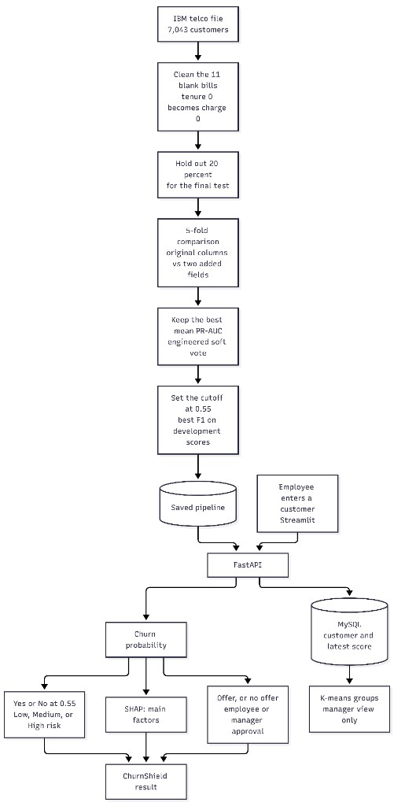

# ChurnShield — Telco retention demo

College ML project: predict telecom churn on the IBM telco dataset, explain scores, compare a domain-feature set under stratified cross-validation, and trace a suggested action to synthetic company rules.

This is a **working local architecture demo**, not a production system. JWT, Docker, and a SELECT-only DB user reduce some risks; they do not make the app “secure” in a real-world sense.

---

## Project purpose

Use the IBM Telco Customer Churn dataset to:

1. Train a binary classifier for `Churn` (Yes/No).
2. Serve individual and batch predictions through FastAPI.
3. Store customers, predictions, and K-Means segments in MySQL.
4. Show manager analytics and employee lookup in Streamlit.
5. Explain individual scores with SHAP.
6. Suggest **rule-based** retention actions (not learned by the model).
7. Optionally answer database questions with an LLM that can only run validated `SELECT` SQL.

---

## Architecture

```
Streamlit frontend  --HTTP/JSON-->  FastAPI backend
                                      |           |
                                      v           v
                                 ML services    MySQL
                                 (sklearn       (app user)
                                  pipeline,
                                  SHAP,
                                  K-Means)
                                      |
                                      v
                                 AI Assistant
                                 (LLM API)
                                      |
                                      v
                                 SQL (SELECT only,
                                 chatbot_user)
```

Training is offline. A customer request loads the saved pipeline. K-means only groups customers already stored for the manager view.



**Choices made for simplicity**

- Streamlit never talks to MySQL. It only calls FastAPI.
- Training is an offline script (`python -m backend.ml.train`), not an HTTP `/train` endpoint.
- One Streamlit app, role-based sidebar. Not two applications.
- Chatbot uses LLM → SQL → MySQL → LLM. Policy RAG is not implemented. Synthetic source documents for a later retrieval step are in `data/mock_company_policies/`.
- LLM provider is swapped with env vars (`LLM_PROVIDER`, `LLM_API_KEY`, `LLM_BASE_URL`).
- Risk labels: **Low < 0.30**, **Medium 0.30–0.70**, **High > 0.70**. These are project-defined business buckets, not universal statistical or medical thresholds.

---

## Folder structure

```
churnfolder/
├── backend/                 FastAPI app
│   ├── main.py              App entry: routes + CORS
│   ├── config.py            Settings from environment variables
│   ├── auth/                Password hashing, JWT, role checks
│   ├── database/            SQLAlchemy engine, models, CRUD
│   ├── ml/                  Clean, train, predict, SHAP, K-Means, retention rules
│   ├── chatbot/             LLM client, prompts, SQL validate + run
│   └── routes/              /login /predict /batch-predict /customers /analytics /chat
├── frontend/                Streamlit UI (calls FastAPI only)
│   ├── app.py               Login + role navigation
│   ├── api_client.py        HTTP helper
│   ├── pages/               Screen modules (not Streamlit’s default multi-page nav)
│   └── components/          Shared widgets
├── data/                    Training CSV and synthetic policy Markdown
├── docs/                    Audit, literature review, research questions, implementation report
├── models/                  Saved pipeline (created by training)
├── notebooks/               Model-development notebook
├── scripts/                 wait_for_db.py, seed.py
├── tests/                   Focused checks for features, protocol, policies, and branding
├── mysql/init.sql           Creates chatbot MySQL user on first volume init
├── docker-compose.yml
├── Dockerfile.backend
├── Dockerfile.frontend
├── requirements.txt
├── .env.example
└── README.md
```

### What each major folder is for

| Folder | Purpose |
| --- | --- |
| `backend/` | Auth, DB access, ML inference, analytics, chatbot. |
| `frontend/` | Forms, charts, tables. No SQL, no LLM keys. |
| `data/` | IBM Telco CSV used to train and to seed MySQL. |
| `models/` | `churn_pipeline.joblib` + metrics + SHAP background + K-Means. |
| `scripts/` | Docker startup: wait for MySQL, train if needed, seed demo data. |
| `mysql/` | First-boot SQL for the SELECT-only chatbot user. |

---

## How the ML pipeline works

1. Load `data/WA_Fn-UseC_-Telco-Customer-Churn.csv`.
2. Clean: `TotalCharges` to numeric. Blanks are set to 0 only when tenure is 0. Other numeric gaps stay missing until a median imputer fitted inside each training fold.
3. Hold out a stratified 20% test set (`random_state=42`) before any model comparison.
4. On the development set only, compare two feature setups with the same stratified 5-fold splits:
   - **Baseline:** the original predictors (`customerID` and `Churn` excluded).
   - **Engineered:** those predictors plus `tenure_group` and `optional_service_count`.
5. Candidates, when the libraries import: logistic regression, random forest, XGBoost, LightGBM, CatBoost, and a soft vote of the three boosters. Class weighting is the main imbalance setting. Unweighted logistic regression, unweighted LightGBM, and training-fold SMOTE (logistic regression only) are compared as well. SMOTE is not applied to validation or test rows.
6. **Selection metric:** mean average precision (PR-AUC) across the five development folds. Precision, recall, and F1 at 0.50 are reported, but they do not choose the model.
7. The decision threshold maximises F1 on out-of-fold development probabilities. The test set is scored once, after that choice, and is written to `final_test_metrics` in `models/training_metrics.json`.
8. Risk labels stay separate from that threshold: **Low &lt; 0.30**, **Medium 0.30–0.70**, **High &gt; 0.70**.
9. The fitted pipeline is saved to `models/churn_pipeline.joblib`. Inference loads it and does not retrain.

The notebook `notebooks/01_model_development.ipynb` is the analysis write-up. `python -m backend.ml.train` repeats the same comparison and overwrites the saved pipeline. Read `docs/IMPLEMENTATION_REPORT.md` for the measured comparison. Do not treat one IBM dataset result as evidence about other operators.

---

## How authentication and JWT work

- Passwords are stored as **bcrypt** hashes in `users`.
- `POST /login` checks username/password and returns a JWT.
- JWT payload includes `user_id`, `sub` (username), `role`, and `exp`.
- Secret: `JWT_SECRET`. Expiry: `JWT_EXPIRE_MINUTES` (default 8 hours).
- Protected routes require `Authorization: Bearer <token>`.
- Roles: `manager` and `employee`.
  - Manager: dashboards, analytics, segments, customers, predict, batch, chat.
  - Employee: lookup by id, predict, batch, chat. **Not** `/analytics` or `/segments`.

Demo users (local only, created by `scripts/seed.py`):

| Username | Password | Role |
| --- | --- | --- |
| `manager` | `manager123` | manager |
| `employee` | `employee123` | employee |

Change these before any real deployment.

---

## How Streamlit talks to FastAPI

`frontend/api_client.py` sends JSON/multipart requests to `BACKEND_URL` (default `http://localhost:8000`). The browser never sees MySQL or `LLM_API_KEY`. In Docker, Streamlit uses `BACKEND_URL=http://backend:8000` because requests run **inside** the frontend container.

---

## How MySQL is used

Tables:

- `users` — login only (not exposed to the chatbot schema).
- `customers` — features for lookup/analytics (not a copy of every training detail you do not need; we store the Telco fields used by the app).
- `predictions` — latest score per `customer_id`.
- `segments` — K-Means `cluster_id` + descriptive `segment_name`.

The training CSV remains the ML source of truth. MySQL is for the **application**.

Two DB users:

1. **Application user** (`MYSQL_USER`) — create/update customers, predictions, users.
2. **Chatbot user** (`CHATBOT_DB_USER`) — **SELECT only** on `customers`, `predictions`, `segments`. No access granted to `users` (password hashes).

`scripts/seed.py` tries to `REVOKE` broad privileges and `GRANT SELECT` on those three tables using the MySQL root password.

---

## Batch prediction

1. Download CSV template from the UI (`GET /batch-template`).
2. Upload CSV → `POST /batch-predict`.
3. Backend checks required feature columns, ignores extras, scores every row with the **saved pipeline**, assigns risk, stores rows, returns a table you can download.

---

## How SHAP works

For one customer, the backend transforms the row with the pipeline preprocessor, then:

- Tree models → `shap.TreeExplainer`
- Logistic regression → `shap.LinearExplainer` plus a training background sample

Factors shown are the largest-magnitude SHAP values, mapped back to readable feature names. If SHAP fails for a model type, the API still returns the prediction and an error string for the explanation. Nothing is invented.

---

## How K-Means segmentation works

Features: `tenure`, `MonthlyCharges`, `TotalCharges` (standardized), `k=4`.

Names compare each cluster’s **mean tenure** and **mean monthly charges** to overall **medians**, e.g. “Shorter tenure, higher monthly charges”. They are **not** “loyal” / “valuable” labels.

---

## Retention recommendations

Independent if-then rules, for example:

- High risk + month-to-month → consider a longer contract offer
- High risk + tenure < 6 → onboarding/support
- High risk + monthly charges ≥ 70 → review plan/value

The model does not learn these actions.

---

## How the chatbot / LLM SQL works

```
Question → FastAPI /chat → LLM writes SQL → validate SELECT-only
        → run as chatbot_user → LLM writes a short answer
```

- Rejects INSERT/UPDATE/DELETE/DROP/ALTER/TRUNCATE/CREATE and similar.
- Multiple statements rejected.
- Even if the model emits a write, MySQL should refuse it for `chatbot_user`.
- Schema sent to the LLM does **not** include `users`.
- The chatbot **does not** call the sklearn model.

**Requires an external API key:** set `LLM_API_KEY`. Without it, `/chat` returns HTTP 503. There are **no fake replies**.

Supported providers (OpenAI-compatible HTTP):

- `LLM_PROVIDER=openai` (default base `https://api.openai.com/v1`)
- `LLM_PROVIDER=groq` (default base `https://api.groq.com/openai/v1`)
- `LLM_PROVIDER=openai_compatible` plus `LLM_BASE_URL` (Ollama, vLLM, Azure-compatible gateways, etc.)

RAG is **not** implemented. `data/mock_company_policies/README.md` describes how a later retrieval step should cite those files without changing the SQL assistant or the saved model.

---

## Security considerations (honest)

Implemented:

- bcrypt password hashes
- JWT with expiry
- role checks on routes
- secrets from environment variables
- Streamlit has no DB or LLM credentials
- chatbot SQL allow-list + SELECT-only MySQL user
- users table omitted from LLM schema

Not implemented / not claimed:

- HTTPS, refresh tokens, lockout, audit logs, rate limits
- row-level security (any logged-in employee can ask the bot for many customer rows)
- prompt-injection robustness
- production hardening of Docker/MySQL

---

## Environment variables

Copy `.env.example` to `.env` and edit.

| Variable | Used by | Required |
| --- | --- | --- |
| `MYSQL_ROOT_PASSWORD` | MySQL + seed grants | Yes for Docker |
| `MYSQL_DATABASE` | MySQL | Yes |
| `MYSQL_USER` / `MYSQL_PASSWORD` | App DB user | Yes |
| `DATABASE_URL` | FastAPI SQLAlchemy | Yes |
| `CHATBOT_DB_USER` / `CHATBOT_DB_PASSWORD` | Chatbot DB user | Yes for chat |
| `CHATBOT_DATABASE_URL` | Read-only engine | Yes for chat |
| `JWT_SECRET` | Token signing | Yes |
| `JWT_ALGORITHM` / `JWT_EXPIRE_MINUTES` | JWT | Defaults OK |
| `BACKEND_URL` | Streamlit | Yes (`http://localhost:8000` locally) |
| `SEED_ON_STARTUP` | Seed script | Default true |
| `CSV_PATH` / `MODELS_DIR` | Train/seed | Defaults OK |
| `LLM_PROVIDER` / `LLM_API_KEY` / `LLM_MODEL` / `LLM_BASE_URL` | Chatbot | **API key required only for chat** |

**Must match:** password in `.env` for `CHATBOT_DB_PASSWORD` and the password in `mysql/init.sql` **before the first** `docker compose up` (MySQL init scripts run only on an empty volume). `seed.py` also `ALTER USER` so later password changes can apply if root is available.

---

## How to train the model

From the project root, with dependencies installed:

```bash
python -m backend.ml.train
```

This writes:

- `models/churn_pipeline.joblib`
- `models/shap_background.npy`
- `models/training_metrics.json`

Docker: if the pipeline file is missing, `scripts/seed.py` trains automatically on first backend start (can take a few minutes).

---

## How to run

### Option A — Docker (MySQL + API + UI)

1. Copy env file:

```bash
copy .env.example .env
```

(On macOS/Linux: `cp .env.example .env`)

2. Put a real `JWT_SECRET` and DB passwords in `.env`. Optionally set `LLM_API_KEY`.

3. Align `mysql/init.sql` chatbot password with `CHATBOT_DB_PASSWORD` if this is the first MySQL volume.

4. Start:

```bash
docker compose up --build
```

5. Open:

- UI: http://localhost:8501
- API docs: http://localhost:8000/docs

First boot: MySQL init → wait → train if needed → import ~7043 customers → K-Means → uvicorn. That can take several minutes.

### Option B — Local Python + Docker MySQL only

Use **Python 3.11 or 3.12** if you can (matches Docker). Python 3.14 works with current unpinned wheels on Windows, but older pinned pandas wheels may fail to build.

```bash
docker compose up mysql -d
python -m venv .venv
.venv\Scripts\activate
pip install -r requirements.txt
copy .env.example .env
```

Set `DATABASE_URL` and `CHATBOT_DATABASE_URL` hosts to `localhost`.

```bash
python -m backend.ml.train
python scripts/seed.py
uvicorn backend.main:app --reload --port 8000
```

Another terminal:

```bash
set PYTHONPATH=.
set BACKEND_URL=http://localhost:8000
streamlit run frontend/app.py
```

PowerShell:

```powershell
$env:PYTHONPATH = "."
$env:BACKEND_URL = "http://localhost:8000"
streamlit run frontend/app.py
```

---

## Request flow (login → dashboard → ML/MySQL/LLM)

1. User submits login in Streamlit → `POST /login`.
2. FastAPI verifies bcrypt hash, returns JWT + role.
3. Streamlit stores the token and shows manager or employee pages.
4. **Predict:** form → `POST /predict` → load `churn_pipeline.joblib` → probability, class, risk → SHAP → rule-based tips → save customer/prediction in MySQL.
5. **Batch:** CSV → `POST /batch-predict` → same pipeline for all rows.
6. **Dashboards/analytics:** `GET /analytics`, `GET /segments`, `GET /customers/{id}` read MySQL only (no retraining).
7. **Chat:** `POST /chat` → LLM SQL → validator → `chatbot_user` SELECT → LLM answer. No pipeline call.

---

## Optional vs required

| Piece | Required to click around predictions/analytics? |
| --- | --- |
| MySQL | Yes |
| Trained `churn_pipeline.joblib` | Yes (script or first Docker seed) |
| Streamlit + FastAPI | Yes |
| `LLM_API_KEY` | **No** — only the AI Assistant page |
| XGBoost | Preferred; training skips it if import fails |
| RAG | Not built |
| Docker | Optional if you run Python + MySQL yourself |

---

## Known limitations

- Single train/test split; no cross-validation or hyperparameter search.
- One prediction row per customer (latest score overwrites).
- Chatbot can return many customer rows to any authenticated user who can call `/chat`.
- SHAP feature names are one-hot columns (`Contract Month-to-month`, etc.), not free-text stories.
- Cluster names are median-split heuristics.
- `mysql/init.sql` is not templated from Compose env on every restart.
- Not load-tested; bcrypt/JWT/SELECT user ≠ production security.

Dataset source used in this prototype: IBM Telco Customer Churn CSV (`customerID` … `Churn`).
